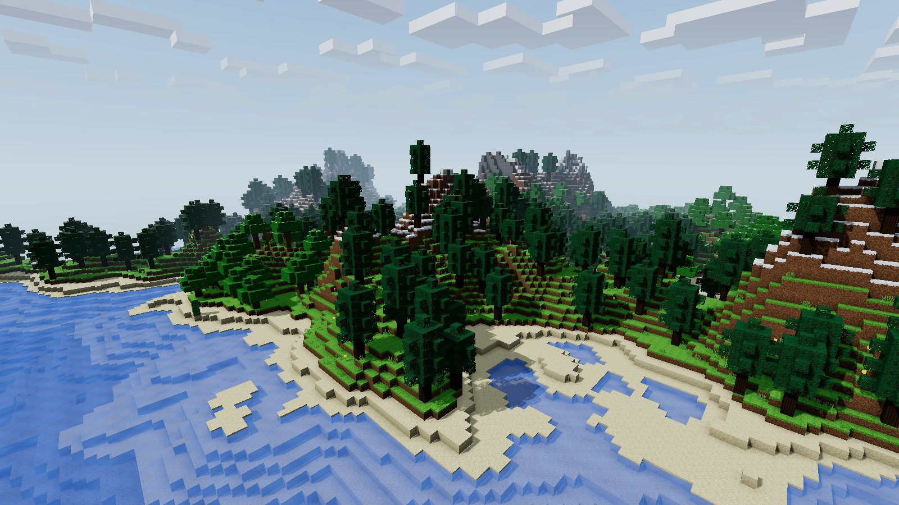
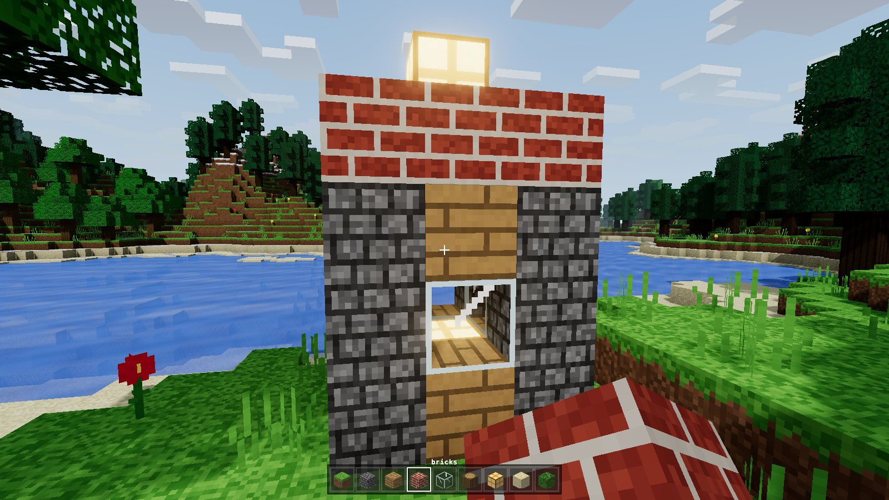
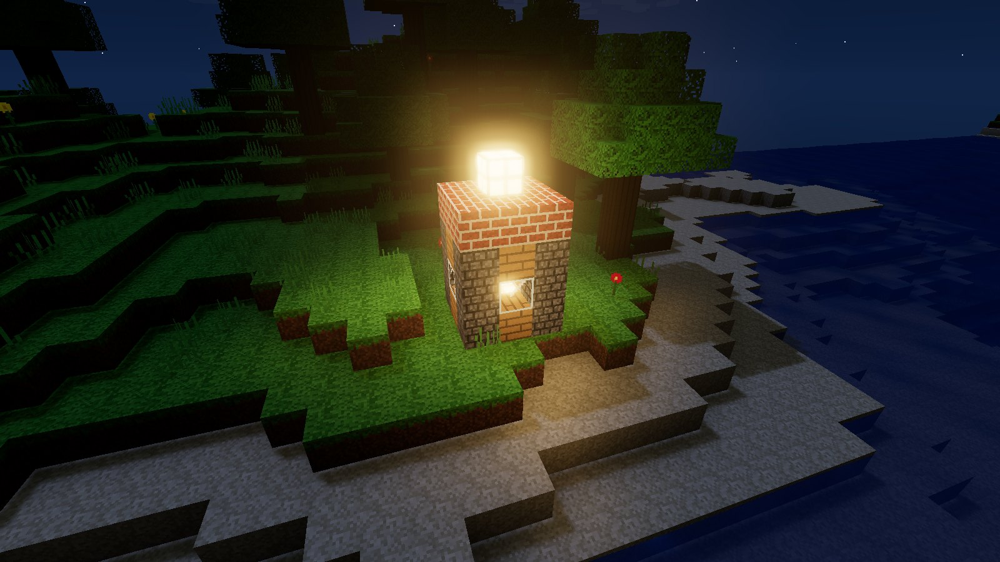

# BLOCKWORLD

A Minecraft-style voxel sandbox that runs in a browser tab. It's one JavaScript file of game
code (`game.js`, 908 lines) plus three.js for rendering. There's no build step, no server and
no install.

It was written by **Claude Opus 5.5** in a single unattended Claude Code session: one task,
no follow-up messages, no hand edits to the code. See [How it was built](#how-it-was-built).



| | |
|---|---|
|  |  |

## Play

- **Locally:** clone the repo and open `index.html` in a modern browser. It works straight
  from `file://` (tested in Chromium and WebKit, the Safari engine; Firefox should work but
  wasn't tested).
- **Online:** turn on GitHub Pages (Settings → Pages → Deploy from a branch → `main` / root).
  The game is then live at `https://<your-username>.github.io/<repo-name>/`.

Click to capture the mouse. Esc releases it.

| key | action |
|---|---|
| W A S D | move |
| Space | jump (in fly mode: up) |
| Shift | sprint |
| F | toggle fly mode (Space up, C down) |
| Left click / Q | break the block you're looking at |
| Right click / two-finger click / ctrl+click / E | place the selected block |
| 1–9 / wheel / two-finger scroll | pick a block from the hotbar |
| G | graphics: high / balanced / battery |
| [ ] | look speed down / up |
| T | skip time (+3 hours) |

### On a laptop / Mac

- **Retina screens start on *balanced*.** That's 1.5× resolution with 2048² shadows, not the
  full 2× pixels that make laptops run hot. **G** switches between *high* (2×, 4096² shadows)
  and *battery* (1×, no shadows). Your choice is remembered.
- **Resolution adapts.** If fps stays under ~48, the render resolution steps down (to 60% at
  the lowest). It climbs back up when there's headroom. The HUD shows the current level.
- **Trackpad friendly.** Two-finger scroll steps the hotbar one slot at a time instead of
  spinning. Ctrl+click works as right click. **Q** and **E** break and place without
  clicking at all. **[ ]** adjusts look speed, and that's remembered too.
- **Battery.** When paused (Esc), it renders at half rate. Cmd-tabbing away releases all keys,
  so you don't come back walking.

## What's in it

**World.** 224 × 72 × 224 blocks (1,601,723 not counting air and water) from a seeded simplex-noise stack:
continental noise plus ridged mountains. It has 7 biomes (ocean, beach, plains, forest, desert,
taiga, snowy peaks), spaghetti caves, coal and gold ore, oak and pine trees, cactus, tall grass
and flowers. There are 24 block types, all with procedurally drawn pixel-art textures (no image
files).

**Rendering.**
- 16×16 chunk meshes with hidden faces culled.
- Per-vertex ambient occlusion, with the quad diagonal flipped so AO doesn't streak.
- Flood-fill block light from lamps, smoothed per vertex.
- A sun and moon shadow map that follows the camera.
- A day/night sky with sun glow, a moon, stars and drifting voxel clouds.
- Animated water with waves, fresnel and sun glare, plus bloom.

**Gameplay.** First-person physics (gravity, jumping, sprinting, swimming, flying, AABB
collision) and DDA ray picking. You can break and place blocks with particles, and there's a
9-slot hotbar with a held-block view that swings when you act.

## How it was built

The whole game came from one task given to Claude Opus 5.5 (Anthropic, released Sep 22 2026)
running in Claude Code while the owner was away. These timestamps come from the session log
([BUILD_LOG.md](BUILD_LOG.md)):

| time | event |
|---|---|
| 20:18:47 | `game.js` started |
| 20:27:24 | first full render: terrain, biomes, caves, trees, water, sky, lamps |
| 20:31:06 | two rendering bugs found and fixed by the model, then its own playtest passed (spawn, walk, jump, fly, break, place) |

That's **12 min 19 s** from an empty file to a playtested game.

Changes after that, all made by the model in the same session:
- For the post's video, three lighting constants were tuned (water specular colour,
  moonlight and ambient intensity).
- `index.html` started as the original `play.html` (asset path changed, `window.game`
  exposed).
- A laptop pass was added: graphics presets, adaptive resolution, trackpad and Mac input,
  and a battery throttle. In `game.js` that's a 24-line patch covering `setPixelRatio`,
  `setShadows` and input. The rest is in `index.html`.

## Poke at it

The game object is exposed as `window.game`, so you can open the devtools console and try:

```js
game.setTime(0.95)                                   // night: 0 midnight, .25 sunrise, .5 noon, .75 sunset
game.fly = true
game.placeBlock(112, 60, 112, Blockworld.BLOCK.LAMP)  // x, y, z, block
```

`index.html#view=x,y,z,yaw,pitch,tod` renders a fixed camera instead of play mode. That's how
the screenshots were taken.

## Limitations

- The world is a fixed 224 × 224 island. There's no infinite terrain or chunk streaming.
- There's no saving. Edits reset on reload.
- It's a sandbox, not survival: no inventory, crafting, mobs or health.
- It still draws about 470k faces. Very old integrated GPUs may sit at the bottom of the
  adaptive range even on *battery*.

## License

MIT (see [LICENSE](LICENSE)). three.js is MIT as well (see
[vendor/LICENSE-three.txt](vendor/LICENSE-three.txt)).
